# 🚦 OndaVerde — semáforos adaptativos com IA

> **CitizenTech · Global Solution FIAP 2026.2 · Mobile Development & IoT**
> O app é a porta de entrada da CitizenTech: é por ele que o cidadão **consulta**, **registra** e **recebe informação** sobre os semáforos inteligentes da cidade e sobre a **onda verde das ambulâncias**.

| | |
|---|---|
| **Integrantes** | Léo Masago — RM 557768<br>Eduardo Tomazela — RM 556807<br>Luiz Henrique Silva — RM 555235 |
| **Vídeo de demonstração (2 min 46 s)** | [youtu.be/oWZ2T3m4Nb0](https://youtu.be/oWZ2T3m4Nb0) |

---

## Ficha da CitizenTech

| Campo | Resposta |
|---|---|
| **Nome da CitizenTech** | **OndaVerde** — semáforos adaptativos com IA. |
| **Cidade e bairro** | São Paulo (SP) — região da Av. Paulista (Bela Vista, Consolação e Jardim Paulista). A rede de 12 cruzamentos do app é fictícia, inspirada nessa região. |
| **Cidadão beneficiado** | Quem se desloca todo dia pela cidade (motoristas, passageiros de ônibus, ciclistas e pedestres) e, principalmente, as pessoas que dependem de uma ambulância chegar rápido. |
| **Problema, em uma frase** | Os semáforos de ciclo fixo dão o mesmo tempo de verde às 3h e às 18h, o que gera congestionamento, poluição e ambulâncias presas no trânsito. |
| **Como funciona** | Cada cruzamento passa a "enxergar" o trânsito em tempo real. Uma IA central decide o tempo de verde de cada semáforo, coordena os cruzamentos vizinhos e abre uma **onda verde** para as ambulâncias. O app mostra isso ao cidadão, que consulta, registra problemas e recebe avisos. Tudo é **simulado em software**. |
| **O que cada parte faz** | • **App OndaVerde** (React Native + Expo): porta de entrada do cidadão, onde ele consulta cruzamentos, registra ocorrências e acompanha a onda verde.<br>• **API da central** (mock): entrega os cruzamentos, as rotas de emergência, os indicadores e os avisos.<br>• **Motor de simulação / IA**: simula o trânsito, divide o tempo de verde conforme o fluxo e abre a onda verde para a ambulância.<br>• **Clima** (Open-Meteo, API real): a chuva aumenta o fluxo de carros na simulação.<br>• **Firebase Firestore**: guarda as ocorrências e a ambulância simulada, com atualização em tempo real. |
| **Link do repositório** | [github.com/LeoMasago/OndaVerde_Mobile](https://github.com/LeoMasago/OndaVerde_Mobile) |
| **Indicador de impacto** | **Espera média por veículo nos cruzamentos** e **tempo economizado pela ambulância**. Na simulação às 18h a espera cai de ≈ 36 s (ciclo fixo) para ≈ 21 s com a IA, cerca de 40 % a menos, e a onda verde poupa de 30 s a mais de 2 min por trajeto. Estimativa para a região: ≈ 60 L de combustível e ≈ 140 kg de CO₂ a menos por hora. Valores simulados, que variam com o horário e aparecem no app em *Início → A IA em números*. |
| **ODS conectados** | **ODS 11** — Cidades e comunidades sustentáveis (mobilidade urbana, principal).<br>**ODS 3** — Saúde e bem-estar (ambulâncias chegam mais rápido).<br>**ODS 9** — Indústria, inovação e infraestrutura (infraestrutura urbana inteligente).<br>**ODS 13** — Ação contra a mudança global do clima (menos combustível queimado em fila). |

### As seis perguntas do briefing

| # | Pergunta | Resposta |
|---|---|---|
| 01 | Quem é o cidadão beneficiado? | Motoristas, passageiros de ônibus, ciclistas, pedestres e quem depende de uma ambulância (campo *Cidadão beneficiado*). |
| 02 | Qual problema será resolvido? | Semáforos de ciclo fixo que não acompanham o trânsito e deixam ambulâncias presas (campo *Problema*). |
| 03 | Como a solução funcionará? | Campo *Como funciona* e a jornada do cidadão no app (seção 1). |
| 04 | Quais tecnologias serão empregadas? | **No protótipo:** React Native, TypeScript, Expo e Expo Router (app); Firebase Firestore (banco em tempo real); API mock da central e API aberta de clima (Open-Meteo); IA simulada em software. **Numa versão real:** sensores e câmeras nos cruzamentos, conexão com os controladores semafóricos e um modelo de otimização/aprendizado na central. |
| 05 | Quem participará do ecossistema? | **Proposta** (não há parcerias reais): cidadãos, que usam o app e registram ocorrências; o órgão de trânsito da prefeitura, que opera os semáforos e trata as ocorrências; SAMU, bombeiros e hospitais, que despacham as ambulâncias e usam a onda verde; empresas de transporte público, nos corredores de ônibus; fornecedores de sensores e de dados abertos, como o clima. |
| 06 | Como o impacto poderá ser medido e ampliado? | **Medido** por espera média por veículo, tempo de chegada da ambulância, combustível e CO₂ evitados, e número de ocorrências com o tempo até serem resolvidas. **Ampliado** começando por um corredor (Av. Paulista), crescendo por avenidas e bairros, passando a usar sensores reais e dados abertos e podendo ser replicado em outras metrópoles. |

### ODS conectados e como o projeto contribui

| ODS | Meta relacionada | Como o OndaVerde contribui |
|---|---|---|
| **11** — Cidades e comunidades sustentáveis | 11.2 (transporte seguro, acessível e sustentável) e 11.6 (reduzir o impacto ambiental das cidades, inclusive a qualidade do ar) | Semáforos que adaptam o verde ao fluxo diminuem a espera e a fila; o cidadão acompanha e relata problemas, o que melhora a gestão do espaço público. Menos veículos parados significa menos poluição local. |
| **3** — Saúde e bem-estar | 3.8 (acesso a serviços de saúde essenciais) | A onda verde reduz o tempo da ambulância até o atendimento: na simulação, de 30 s a mais de 2 min por trajeto. |
| **9** — Indústria, inovação e infraestrutura | 9.1 (infraestrutura de qualidade, confiável e resiliente) | Propõe uma infraestrutura urbana inteligente, orientada por dados, que se adapta à demanda em vez de seguir um ciclo fixo. |
| **13** — Ação contra a mudança global do clima | — | Menos combustível queimado em fila: na simulação, ≈ 60 L e ≈ 140 kg de CO₂ a menos por hora na região (estimativa). |

**Contexto da proposta**

- **Tema:** melhor organização das cidades com tecnologia e inovação.
- **Proposta:** sistema de semáforos adaptativos com IA que libera o fluxo de forma inteligente nas grandes metrópoles e abre "ondas verdes" para ambulâncias.
- **Natureza:** projeto demonstrativo, em forma de proposta, **todo simulado em software**. Não há semáforos, câmeras, trânsito ou ambulâncias reais.

**Stack:** React Native 0.88 · TypeScript (strict) · Expo SDK 58 · Expo Router · Firebase Firestore · react-native-svg

---

## 1. Jornada do cidadão no app

O objetivo é o app resolver uma jornada simples, em três passos: **consultar**, **registrar** e **receber informação**.

1. **Consultar** — *Início* resume o trânsito da região (fluido / moderado / intenso), a espera média por carro e quanto a IA economiza em relação ao ciclo fixo. *Cruzamentos* mostra um mapa esquemático e uma lista; ao tocar em um cruzamento vê-se o semáforo ao vivo (com contagem regressiva) e **o que a IA decidiu** em linguagem simples.
2. **Registrar** — *Ocorrências → Registrar ocorrência*: três passos (o que aconteceu, onde, detalhes opcionais). A ocorrência é salva no **Firestore** e aparece na hora para todos. O autor pode marcar como resolvida ou apagar; outros cidadãos podem confirmar ("também vi isso").
3. **Receber informação** — *Avisos para você* (decisões da IA, chuva, cruzamento mais carregado, ocorrências de outras pessoas) e a aba **Onda Verde**, onde uma ambulância simulada percorre uma rota enquanto os semáforos abrem à frente dela. O cidadão vê por onde ela passa e recebe a orientação de dar passagem.

---

## 2. Prints das telas

> Capturados na versão web em viewport de celular (390 × 844). O app roda em Android e iOS pelo Expo Go.

| Início | Painel da simulação | Mapa de cruzamentos |
|:--:|:--:|:--:|
| 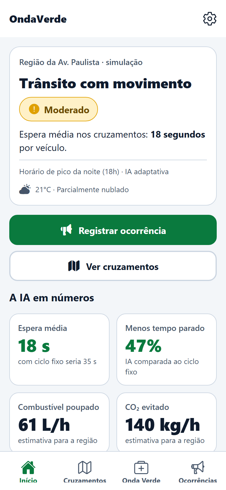 | 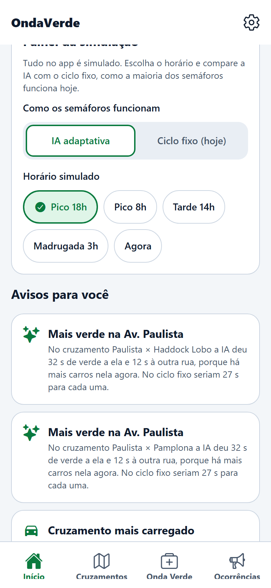 | 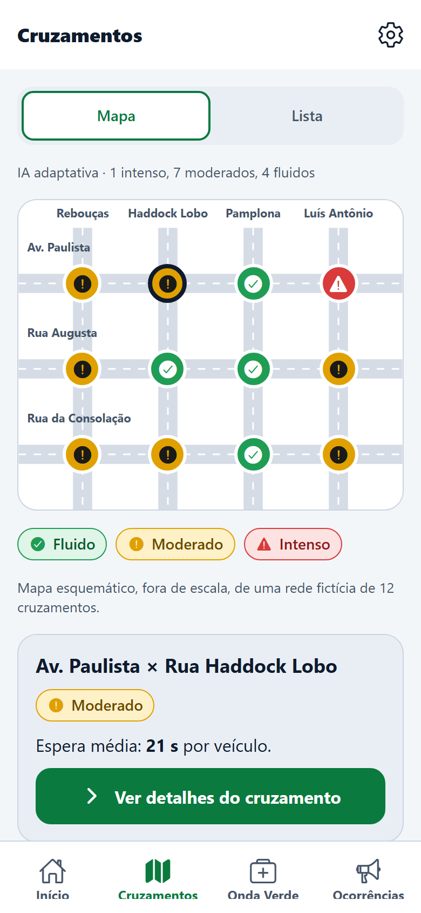 |

| Detalhe do cruzamento | O que a IA decidiu | Onda Verde: escolher rota |
|:--:|:--:|:--:|
| 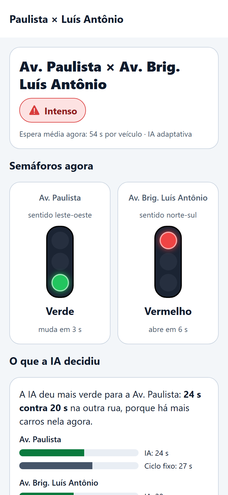 | 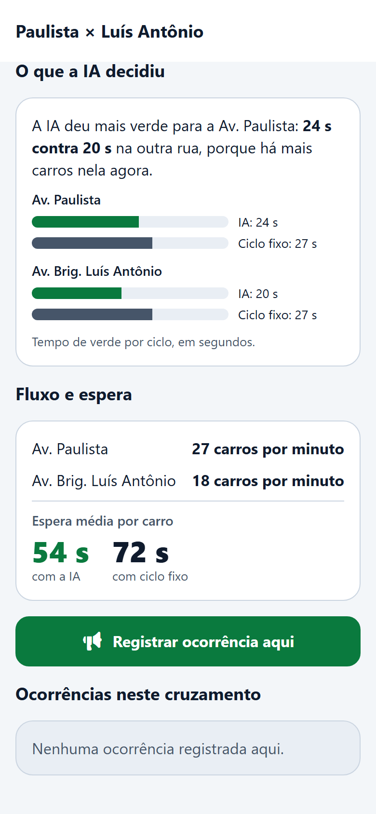 | 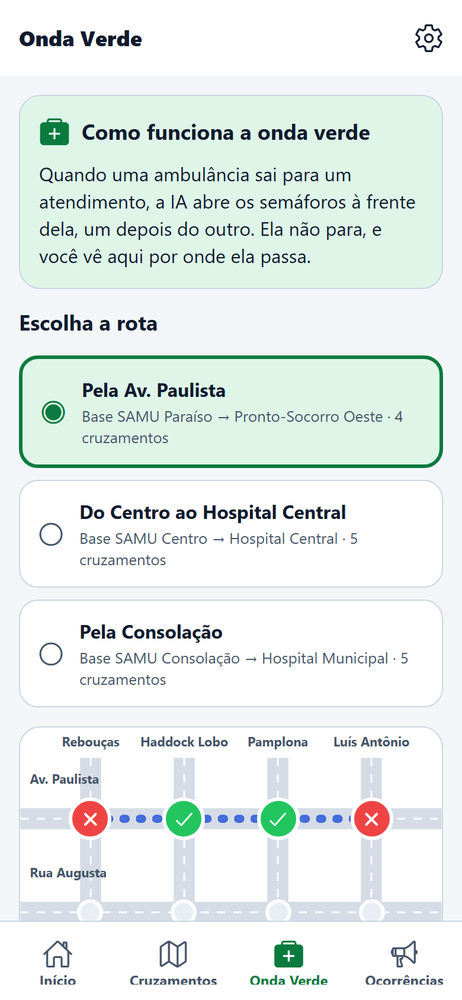 |

| Onda Verde ativa | Tempo economizado | Registrar ocorrência |
|:--:|:--:|:--:|
| 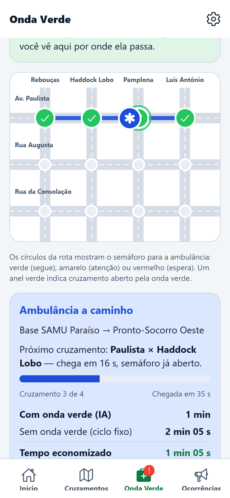 | 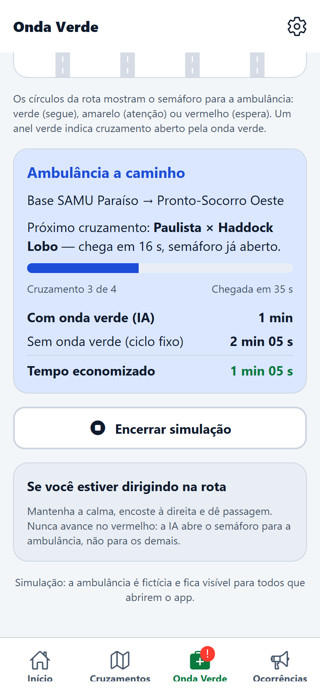 | 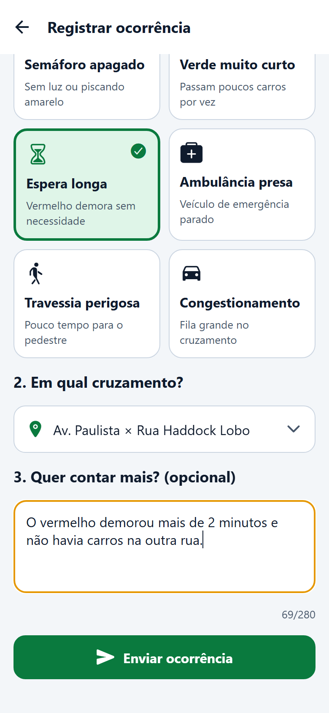 |

| Lista de ocorrências | Ajustes e acessibilidade | Alto contraste + texto grande |
|:--:|:--:|:--:|
| 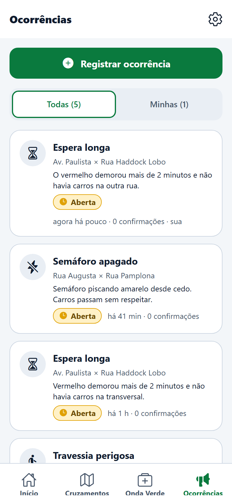 | 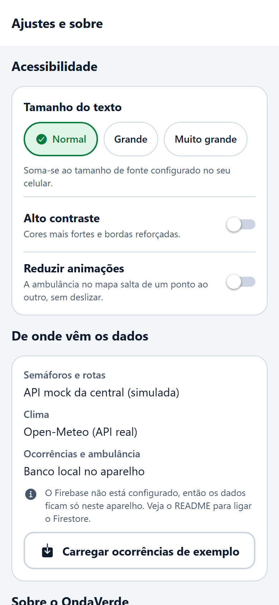 | 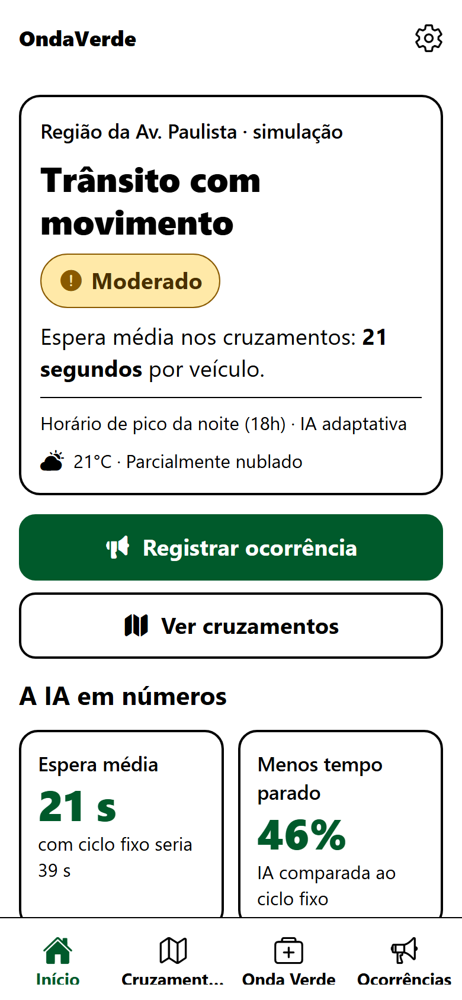 |

Todos os prints estão em [`docs/screenshots`](docs/screenshots).

---

## 3. Como rodar

**Pré-requisitos:** Node.js 22+ e o app **Expo Go** (versão compatível com o SDK 58) no celular, ou um emulador Android/iOS.

```bash
npm install
```

```bash
npx expo start
```

Escaneie o QR code com o Expo Go (Android) ou com a câmera (iOS). Para abrir no navegador: `npm run web`.

> O `npm install` pode exibir avisos `EBADENGINE` do pacote `firebase` em Node anterior ao 24. São avisos do npm; o app funciona normalmente.

### Firebase (Firestore)

**Este repositório já inclui o `.env`** com a configuração do Firebase do grupo (projeto `gs-mobile-citizentech`). Por isso, rodando `npm install` e `npx expo start`, o app já grava no **Firestore**, sem configurar nada. Se o `.env` for removido, o app continua funcionando e salva as ocorrências só no aparelho (banco local).

Para usar o **seu próprio projeto Firebase**:

1. No [Console do Firebase](https://console.firebase.google.com/), crie um projeto e adicione um **app da Web** (ícone `</>`). Copie o objeto `firebaseConfig`.
2. Crie o banco em **Firestore Database → Criar banco de dados**.
3. Em **Firestore Database → Regras**, cole o conteúdo de [`firestore.rules`](firestore.rules) e publique.
4. Troque os valores do `.env` pelos do passo 1 (o `.env.example` mostra os nomes das variáveis). Isso substitui a configuração do grupo.

5. Reinicie limpando o cache para o Metro ler as variáveis:

   ```bash
   npx expo start -c
   ```

Em **Ajustes → De onde vêm os dados** o app mostra se está usando *Firebase Firestore (nuvem)* ou *Banco local no aparelho*.

> Se aparecer "Missing or insufficient permissions" logo depois de publicar as regras, aguarde cerca de um minuto e toque em **Tentar de novo**: as regras levam um instante para valer.

> **Sobre o `.env` no repositório:** a chave web do Firebase não é secreta (quem protege os dados são as regras do Firestore, e elas aqui são abertas, de projeto demonstrativo). O `.env` foi mantido no repositório de propósito, para quem avaliar usar o banco do grupo. Quem preferir manter a configuração privada pode usar um `.env.local`, que já está no `.gitignore`.

### Dicas para a demonstração

- **Painel da simulação** (tela Início): alterne entre **IA adaptativa** e **Ciclo fixo (hoje)** e entre os horários (3h, 8h, 14h, 18h, agora) para ver a diferença nos números e no mapa. O padrão é o pico das 18h.
- **Onda Verde**: toque em *Simular chamada de ambulância*. A ambulância é gravada no banco, então **outro celular com o app a vê ao mesmo tempo**. Troque para *Ciclo fixo* durante a simulação para ver a ambulância parar nos vermelhos.
- **Ocorrências vazias?** Use *Carregar exemplos para a demonstração*.

---

## 4. Navegação e telas

Navegação com **Expo Router** (rotas baseadas em arquivos, em `src/app`): 4 abas + telas empilhadas e um modal.

```
src/app
├─ _layout.tsx             Providers (configurações, API, banco) + Stack
├─ (tabs)
│  ├─ _layout.tsx          Barra de abas
│  ├─ index.tsx            Início: situação, números da IA, painel da simulação, avisos
│  ├─ cruzamentos.tsx      Mapa | Lista, filtro por nível de trânsito
│  ├─ onda-verde.tsx       Simulação da ambulância e da onda verde
│  └─ ocorrencias.tsx      Todas | Minhas, em tempo real
├─ cruzamento/[id].tsx     Semáforos ao vivo, decisão da IA, fluxo e espera
├─ ocorrencia/nova.tsx     Modal: registrar ocorrência (3 passos)
├─ ocorrencia/[id].tsx     Detalhe: confirmar, resolver, apagar
└─ ajustes.tsx             Acessibilidade, fontes de dados, sobre o projeto
```

---

## 5. Dados

### 5.1 Consumo de dados (API / mock)

| Fonte | O que traz | Tipo |
|---|---|---|
| `src/services/api/trafficApi.ts` | `GET /network` (cruzamentos e rotas) e `GET /overview` (indicadores e avisos) | **API mock** com latência de rede simulada (350–800 ms) |
| `src/services/api/weatherApi.ts` | Temperatura e chuva da região da Paulista | **API real** [Open-Meteo](https://open-meteo.com/) (sem chave), com valor de exemplo se estiver sem internet |

- A central é carregada ao abrir o app, com **tela de carregamento** e **tela de erro com "Tentar de novo"** (`NetworkProvider`).
- O `GET /overview` é consultado a cada 15 s (*polling*) e ao **puxar a tela para atualizar**, sempre mantendo os dados anteriores na tela enquanto recarrega (`useQuery`).
- Para trocar o mock por um backend real basta substituir `request()` em `trafficApi.ts` por um `fetch`; as telas só conhecem as funções exportadas.
- A **chuva real** entra na simulação: o fluxo de carros aumenta 10 % e a IA ajusta os tempos.

### 5.2 Banco de dados (Firebase Firestore)

Duas coleções, com operações completas de **criar, ler em tempo real (`onSnapshot`), atualizar e apagar**:

```text
ocorrencias/{id}
  tipo              string    semaforo_apagado | verde_curto | espera_longa |
                              ambulancia_presa | travessia_pedestre | congestionamento
  intersectionId    string    ex.: "c-0-1"
  intersectionName  string    ex.: "Av. Paulista × Rua Haddock Lobo"
  descricao         string    até 280 caracteres (opcional)
  status            string    aberta | resolvida
  autorId           string    identificador anônimo do aparelho (sem login)
  confirmadoPor     string[]  quem clicou em "Também vi isso" (arrayUnion)
  criadaEm          timestamp serverTimestamp()

emergencias/{id}
  routeId           string    rota da ambulância simulada
  startedAtMs       number    instante de partida (todos os celulares calculam a posição a partir dele)
  status            string    ativa | encerrada
  autorId           string
```

- **Criar:** registrar ocorrência e iniciar a ambulância.
- **Ler:** listas atualizadas em tempo real em todos os aparelhos.
- **Atualizar:** *Também vi isso* (`arrayUnion`), *Marcar como resolvida*, encerrar a simulação.
- **Apagar:** *Apagar minha ocorrência* (com confirmação na própria tela).
- **Sem login:** o `autorId` é um identificador gerado e guardado no aparelho (AsyncStorage) — é o que separa *Todas* de *Minhas*.
- **Alternativa local:** `src/services/db/localStore.ts` implementa a mesma interface (`DataStore`) com AsyncStorage, usada quando o `.env` não está preenchido.
- **Erros tratados:** falta de internet (escritas têm *timeout* de 10 s), regra negada pelo Firestore e falha de leitura aparecem com mensagem em português e botão de nova tentativa.

> As regras em [`firestore.rules`](firestore.rules) são de **projeto demonstrativo** (sem autenticação): validam o formato da ocorrência e limitam o que pode ser alterado. Em um produto real, use Firebase Authentication e restrinja alterações ao autor.

### 5.3 Origem dos dados e privacidade

O projeto **não usa nenhum dado pessoal real**. Todos os dados vêm de uma destas origens:

| Dado | Origem |
|---|---|
| Cruzamentos, fluxo de carros, semáforos, ambulância, indicadores | **Simulados** pelo motor em `src/services/traffic` (rede fictícia, inspirada na região da Av. Paulista). |
| Clima (temperatura e chuva) | **Públicos**: API [Open-Meteo](https://open-meteo.com/), sem chave e sem enviar dados do usuário. |
| Ocorrências de exemplo | **Fictícias**, criadas por `src/services/db/index.ts` (botão *Carregar exemplos*). |
| Ocorrências registradas no app | Texto livre digitado pelo próprio usuário, ligado a um **identificador anônimo** do aparelho (sem nome, e-mail, telefone ou localização). |

Os nomes das ruas são públicos; os hospitais e as bases do SAMU têm nomes genéricos de propósito.

---

## 6. A "IA" simulada

Como o projeto é demonstrativo, a IA é um **controlador adaptativo baseado em regras** (`src/services/traffic/engine.ts`), com funções puras e determinísticas: dado o cruzamento, o horário e o instante, o resultado é sempre o mesmo — por isso todos os celulares mostram o mesmo semáforo ao mesmo tempo, sem servidor.

| Elemento | Como funciona |
|---|---|
| **Fluxo de carros** | Pico de cada rua × curva do dia (picos às 8h e 18h, madrugada ≈ 10 %) × tendência direcional × variação lenta × chuva. |
| **Ciclo fixo (como é hoje)** | 60 s, 27 s de verde para cada rua, 3 s de amarelo. Igual às 3h e às 18h. |
| **IA adaptativa** | A cada ciclo divide o verde **em proporção ao fluxo de cada rua** (mínimo de 12 s), usa ciclos de 40 s quando o movimento é baixo (madrugada) e de 50 s no resto do dia e **defasa os cruzamentos vizinhos** das avenidas leste-oeste (22 s por quarteirão) para formar ondas de coordenação. |
| **Espera média por carro** | Fórmula clássica de atraso em semáforo (Webster + saturação do *Highway Capacity Manual*). Nível: fluido ≤ 12 s, moderado ≤ 22 s, intenso > 22 s. |
| **Economia** | Diferença de espera entre ciclo fixo e IA, convertida em combustível (0,6 L por veículo-hora parado) e CO₂ (2,3 kg/L). São **estimativas simuladas**. |
| **Onda verde** | Para cada cruzamento da rota o semáforo abre 12 s antes da ambulância chegar (com 3 s de limpeza do eixo cruzado) e fecha 5 s depois. Sem a onda, a ambulância fica sujeita ao ciclo fixo, ao trânsito mais lento e aos vermelhos — a diferença é mostrada em segundos. |

Em um sistema real, esse módulo seria substituído por um modelo treinado/otimizador alimentado por sensores e câmeras; a interface do app não mudaria.

---

## 7. Acessibilidade

- **Texto ajustável**: três tamanhos no app (Normal, Grande, Muito grande), somados à fonte do sistema.
- **Alto contraste** (preto e branco puros, bordas reforçadas) e **modo escuro automático** pelo sistema.
- **Reduzir animações**: respeita o ajuste do sistema e também tem opção no app.
- **Nunca só cor**: o nível de trânsito sempre vem com **ícone + palavra** (✔ Fluido, ! Moderado, ▲ Intenso); o semáforo mostra a lâmpada e o nome da cor.
- **Leitores de tela (TalkBack/VoiceOver)**: todos os botões têm rótulo, papel (`button`, `radio`, `tab`, `switch`, `progressbar`) e estado; cada cruzamento do mapa é um botão com descrição falada; tempos são lidos por extenso ("1 minuto e 30 segundos"); mudanças importantes são anunciadas.
- **Alternativa ao mapa**: a visão em **Lista** traz as mesmas informações para quem não consegue usar o mapa.
- **Alvos de toque** de pelo menos 48 dp e botões grandes com rótulo sempre visível.
- **Linguagem simples**: frases curtas, sem jargão de engenharia de tráfego ("espera média" em vez de "atraso por veículo").
- **Formulário claro**: três passos numerados, erros ao lado do campo (com ícone e texto) e contador de caracteres.

---

## 8. Estrutura do código

```
src
├─ app/            Rotas (Expo Router)
├─ components/     Interface reutilizável: AppText, Button, Card, Chip, TrafficMap, TrafficLight…
├─ domain/         Tipos, rede de 12 cruzamentos, rotas de emergência, tipos de ocorrência
├─ hooks/          useQuery, useNow, useTraffic (estado ao vivo da rede e da ambulância)
├─ services/
│  ├─ api/         trafficApi (mock) e weatherApi (Open-Meteo)
│  ├─ db/          DataStore: Firestore + banco local, ID do aparelho, dados de exemplo
│  ├─ firebase/    Configuração e inicialização do Firebase
│  └─ traffic/     Motor de simulação (engine) e ambulância/onda verde (emergency)
├─ state/          Contextos: configurações/tema, rede (API) e banco de dados
├─ theme/          Paletas (claro, escuro e alto contraste)
└─ utils/          Formatação em português e mensagens de erro
```

Comandos úteis:

```bash
npx tsc --noEmit     # checagem de tipos
npx expo lint        # ESLint
npx expo-doctor      # diagnóstico de dependências
```

---

## 9. Critérios de avaliação × onde estão no projeto

| Critério | Como o projeto atende |
|---|---|
| **Telas e navegação** | 4 abas + detalhe de cruzamento, detalhe de ocorrência, formulário em modal e ajustes; Expo Router com rotas dinâmicas (`/cruzamento/[id]`) e estados de carregamento, vazio e erro em todas as listas. |
| **Consumo de dados** | API mock da central de semáforos (com latência, *polling*, *pull-to-refresh*, erro e nova tentativa) e API real de clima (Open-Meteo) que influencia a simulação. |
| **Banco de dados** | Firebase Firestore com criar, ler em tempo real, atualizar e apagar; ambulância compartilhada entre aparelhos; alternativa local com a mesma interface. |
| **Acessibilidade** | Seção 7: texto ajustável, alto contraste, escuro, rótulos e papéis para leitores de tela, informação nunca só por cor, alvos de toque grandes. |
| **Aderência ao problema** | Mostra a diferença entre ciclo fixo e IA por horário, cruzamentos vizinhos coordenados e a onda verde para ambulâncias, tudo simulado em software como a proposta pede. |
| **Documentação** | Este README (ficha com as seis perguntas do briefing, ODS, instruções, prints, dados, IA simulada, acessibilidade), o [vídeo de demonstração](https://youtu.be/oWZ2T3m4Nb0) e o registro de prompts em [`prompts.md`](prompts.md). |

---

## 10. Limitações conhecidas

- Os cruzamentos formam uma **rede fictícia** (inspirada na região da Av. Paulista); o mapa é esquemático e fora de escala.
- A IA é simulada com regras; não há aprendizado de máquina nem sensores reais.
- Sem login: `autorId` é anônimo e as regras do Firestore são abertas com validação básica (adequado a uma demonstração).
- Avisos *push* não foram implementados: os avisos aparecem dentro do app.

---

## 11. Uso de IA como copiloto

Este projeto foi desenvolvido com apoio de uma IA (Claude Code). Os prompts usados estão registrados em [`prompts.md`](prompts.md), junto com um roteiro para estudar o código e conseguir explicar cada parte.
